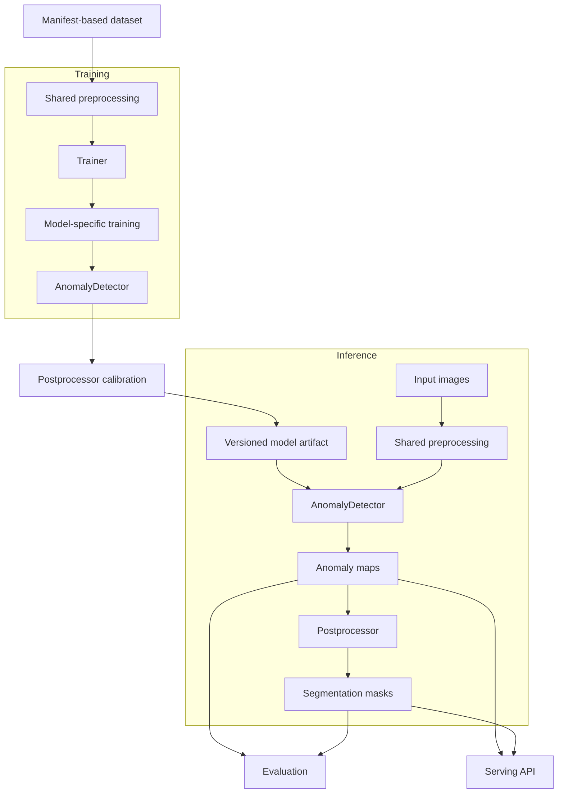

# Visual Inspection Platform

[](https://github.com/adampirog/visual-inspection-platform/actions/workflows/ci.yml)
[](https://github.com/astral-sh/ruff)


An extensible computer vision platform for industrial anomaly detection and defect segmentation, designed for reproducible experimentation, modular model development and efficient deployment.

The platform provides a unified workflow for training, evaluating and serving classical machine learning and deep learning models, with inference independent of their training frameworks.

## Features

- **Unified model API** — interchangeable anomaly detectors and trainers with consistent prediction, serialization and evaluation interfaces.
- **Flexible data pipeline** — dataset-independent CSV manifests, shared image preprocessing and on-demand image loading.
- **Deep learning training** — PyTorch and Lightning integration with configurable optimization, learning rate scheduling, early stopping and checkpoint selection.
- **Defect segmentation** — pixel-level anomaly maps with calibrated global and spatial thresholding.
- **Evaluation** — pixel-level AUROC, Average Precision, Precision, Recall and Dice, with per-category results and macro averages.
- **Efficient inference** — lightweight NumPy and ONNX Runtime implementations, dynamic batching and model-specific dependency isolation.
- **Model artifacts** — self-contained, versioned artifacts with training metadata and postprocessor state.
- **Deployment** — multi-model FastAPI serving with artifact discovery, lazy loading, batch inference and Docker support.

## Supported Models

| Model                           | Approach                       | Training           | Inference    |
| ------------------------------- | ------------------------------ | ------------------ | ------------ |
| PCA                             | Global image reconstruction    | Scikit-learn       | NumPy        |
| Convolutional Autoencoder (CAE) | Nonlinear image reconstruction | PyTorch, Lightning | ONNX Runtime |

All models implement the same `AnomalyDetector` interface, producing pixel-level anomaly scores that can be converted into binary segmentation masks through a configurable postprocessor.

## Architecture



The architecture is built around independent components with explicit interfaces and responsibilities:

- **Data and preprocessing** are shared across model families, ensuring consistent inputs during training, evaluation and serving.
- **Training and inference** are decoupled. Deep learning models are exported to ONNX, removing PyTorch and Lightning from the inference environment.
- **Postprocessing** is independent of the detector, allowing segmentation thresholds to be calibrated and replaced without retraining.
- **Evaluation and serving** operate on the common detector interface rather than model-specific implementations.

Configurations and artifact metadata are validated using Pydantic. Model-specific dependencies are isolated through optional installation extras.

## Installation

Requires Python 3.13 or newer.

```bash
git clone https://github.com/adampirog/visual-inspection-platform.git
cd visual-inspection-platform

pip install -e ".[all]"
```

For environments requiring only selected functionality, the following extras are available:

| Extra           | Functionality                           |
| --------------- | --------------------------------------- |
| `pca-inference` | PCA inference                           |
| `pca-training`  | PCA training and inference              |
| `cae-inference` | CAE inference                           |
| `cae-training`  | CAE training, ONNX export and inference |
| `evaluation`    | Model evaluation and reporting          |
| `serving`       | HTTP inference API                      |
| `all`           | All supported functionality             |

For inference and serving without training dependencies:

```bash
pip install -e ".[serving,pca-inference,cae-inference]"
```

For GPU training, install a PyTorch build compatible with the target hardware using the [official installation instructions](https://pytorch.org/get-started/locally/).

## Datasets

The primary benchmark is [Visual Anomaly (VisA)](https://github.com/amazon-science/spot-diff), an industrial anomaly detection dataset containing 10,821 images across 12 object categories, with image-level and pixel-level annotations.

Download the dataset and its official one-class split manifest:

```bash
mkdir -p data/visa

curl -L \
    https://amazon-visual-anomaly.s3.us-west-2.amazonaws.com/VisA_20220922.tar \
    -o data/VisA.tar

tar -xf data/VisA.tar -C data/visa

curl -L \
    https://raw.githubusercontent.com/amazon-science/spot-diff/main/split_csv/1cls.csv \
    -o data/visa/1cls.csv
```

The platform operates directly on the original dataset structure. No image duplication or directory reorganization is required.

Custom datasets can be integrated using a CSV manifest with the following columns:

```text
object,split,label,image,mask
```

Image and mask paths are relative to the dataset root. Dataset-specific labels are mapped to a boolean representation, where `True` indicates an anomaly.

## Quickstart

The following example demonstrates the complete workflow using a convolutional autoencoder trained on the `cashew` category.

### Data Preparation

```python
from visual_inspection_platform.data import ImageRecordsDataset


dataset_config = {
    "manifest": "data/visa/1cls.csv",
    "data_dir": "data/visa",
    "label_map": {"normal": False, "anomaly": True},
    "objects": {"cashew"},
}

data = ImageRecordsDataset(**dataset_config, split="train")
test = ImageRecordsDataset(**dataset_config, split="test")

calibration = data[:64]
validation = data[64:128]
train = data[128:]
```

Training, validation and calibration use disjoint subsets of normal images. The annotated test set is reserved for final evaluation.

### Training

```python
from visual_inspection_platform.models.cae.trainer import CAEConfig, CAETrainer


trainer = CAETrainer(
    CAEConfig(
        image_size=(128, 128),
        latent_channels=64,
        batch_size=32,
        max_epochs=100,
        random_state=42,
        accelerator="cpu",
    )
)

model = trainer.fit(
    train,
    validation_data=validation,
    run_dir="runs/cae",
)
```

The trainer selects the best checkpoint according to validation reconstruction loss and exports the trained network to ONNX. The returned detector is ready for inference.

The run directory contains the training configuration, checkpoints and CSV experiment logs.

<details>
<summary>Alternative: PCA training</summary>

```python
from visual_inspection_platform.models.pca.trainer import PCAConfig, PCATrainer


trainer = PCATrainer(
    PCAConfig(n_components=32, image_size=(64, 64))
)

model = trainer.fit(train)
```

The remaining calibration, evaluation and deployment workflow is identical.

</details>

### Calibration and Evaluation

```python
from visual_inspection_platform.evaluation.evaluate_model import evaluate_model
from visual_inspection_platform.postprocessors import ThresholdPostprocessor


normal_maps = model.predict(
    calibration.load_images(model.image_size)
)

model.postprocessor = ThresholdPostprocessor.calibrate(
    normal_maps,
    quantile=0.995,
)

result = evaluate_model(model, test, batch_size=32, verbose=True)

print(result)
result.save("evaluation.json")
```

Evaluation includes continuous anomaly detection metrics and, when a postprocessor is configured, binary segmentation metrics.

For spatially aligned images, `SpatialThresholdPostprocessor` provides location-specific threshold calibration through the same interface.

### Serialization

```python
model.save(f"artifacts/{model.model_id}")
```

Model artifacts contain a common manifest, model-specific parameters and optional postprocessor state.

```text
artifacts/
└── MODEL_ID/
    ├── MANIFEST.json
    ├── model.onnx
    └── postprocessor/
```

The example represents a CAE artifact. PCA artifacts store their parameters in `pca.npz`.

Training checkpoints and experiment logs are separate from deployable artifacts and are not required for inference.

## Deployment

### Python Inference

```python
from visual_inspection_platform.models.cae import CAEDetector
from visual_inspection_platform.utils.images import load_images


model = CAEDetector.load("artifacts/MODEL_ID")

images = load_images(["image.png"], size=model.image_size)

anomaly_maps = model.predict(images)
masks = model.predict_mask(anomaly_maps)
```

For PCA artifacts, use `PCADetector` from `visual_inspection_platform.models.pca`.

Detectors accept RGB float32 arrays of shape `[N, 3, H, W]` with values in `[0, 1]` and return anomaly maps of shape `[N, H, W]`. Binary mask prediction requires a configured postprocessor.

CAE inference uses ONNX Runtime on CPU and requires no deep learning training framework.

### REST API

Start the inference server:

```bash
python -m visual_inspection_platform.serving.app artifacts
```

List available models:

```bash
curl http://localhost:8000/v1/models
```

Generate predictions:

```bash
curl -X POST \
    "http://localhost:8000/v1/models/MODEL_ID/predictions?include_masks=true" \
    -F "files=@image.png"
```

The server supports multiple model families, lazy model loading and batch inference.

| Method | Endpoint                            | Purpose                |
| ------ | ----------------------------------- | ---------------------- |
| GET    | `/health`                           | Service health         |
| GET    | `/v1/models`                        | Available models       |
| POST   | `/v1/models/{model_id}/predictions` | Batch inference        |
| POST   | `/admin/models/refresh`             | Discover new artifacts |
| POST   | `/admin/models/{model_id}/load`     | Load a model           |
| DELETE | `/admin/models/{model_id}/load`     | Unload a model         |

Interactive API documentation is available at [localhost:8000/docs](http://localhost:8000/docs).

### Docker

```bash
docker build -t visual-inspection-platform .

docker run --rm \
    -p 127.0.0.1:8000:8000 \
    -v "$(pwd)/artifacts:/models:ro" \
    visual-inspection-platform
```

The container uses a multi-stage build and runs as a non-root user without model training dependencies.

## Roadmap

### Models

- [x] PCA reconstruction
- [x] Convolutional Autoencoder
- [ ] PaDiM
- [ ] PatchCore
- [ ] SimpleNet
- [ ] EfficientAD
- [ ] DINO-based anomaly detection
- [ ] Dinomaly

### Platform

- [ ] Reproducible multi-model benchmarks on VisA
- [ ] Additional dataset integration (MVTec AD)
- [ ] Hyperparameter tuning and experiment comparison
- [ ] GPU-accelerated inference
- [ ] FP16 and INT8 inference optimization
- [ ] CPU and GPU performance benchmarking

## Development

Install the development environment:

```bash
pip install -e ".[all]" --group dev
```

Run static checks and tests:

```bash
ruff check .
ruff format --check .
pytest
```

The test suite covers model training, numerical correctness, artifact serialization, evaluation and serving integration, including PyTorch–ONNX Runtime numerical parity.

Tests use synthetic data and CPU execution, requiring neither external datasets nor GPU hardware.

## License

This project is licensed under the [MIT License](LICENSE). External datasets are subject to their respective licenses.
